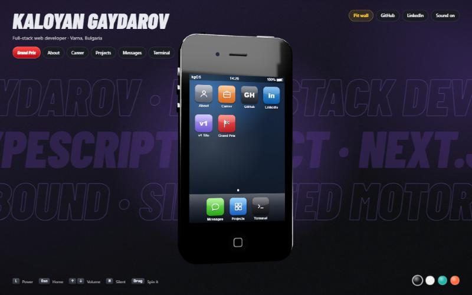
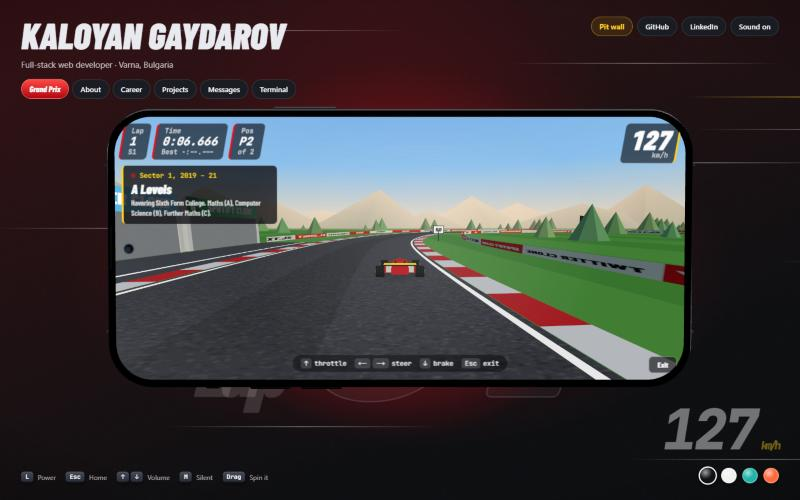
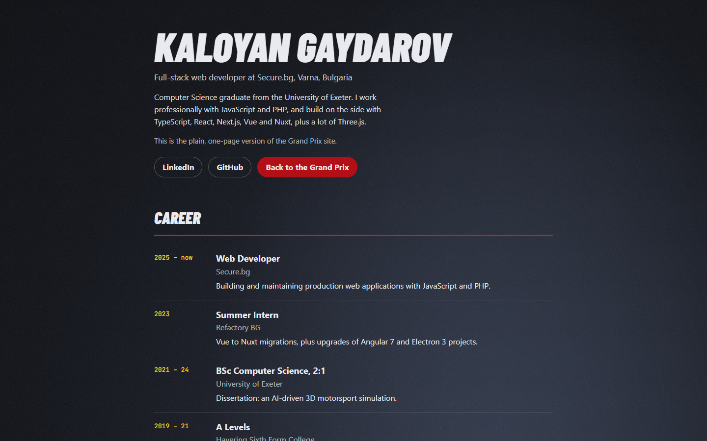

# KG Grand Prix — Kaloyan Gaydarov's portfolio


**A portfolio you play.** A 3D phone of my own design that you can spin, unlock and use, with a racing game inside it. You drive one lap of my career, then pull into the pit lane to try my projects.

**Live:** https://iphoneporfolio.vercel.app &nbsp;·&nbsp; **Plain version:** https://iphoneporfolio.vercel.app/pit-wall





## What it does

- **A phone built entirely in code.** An original modern handset (flat satin frame, punch-hole camera, frosted back with a pill-shaped camera block) modelled from extruded shapes and physical materials in Three.js, with no 3D model files. Drag it to spin it; it springs back with your swipe's speed carried through. Its side buttons work: power, volume and the silent switch.
- **kgOS 5, its own interface.** The screen is real HTML mapped onto the 3D glass: swipe up to unlock, a home screen with profile and Grand Prix widgets, and a home bar to go back. There are apps for About, Career, Projects, Messages, a Terminal with its own command parser, a live GitHub feed, a LinkedIn card, and an in-phone browser that opens my projects' live sites.
- **The Grand Prix.** Press it and the phone turns on its side into a handheld console. A 3D race runs on the phone's screen:
  - start lights, a lap timer, and a best lap saved in your browser
  - an AI rival that brakes for each corner from a computed speed profile
  - four sectors, one per chapter of my career, each with a trackside billboard and a radio message
  - a pit lane with a garage for each project: park at one, the door rolls up, and you can open the project live
  - a chequered flag, then a podium with my contact links
  - **Watch a lap**: an autopilot drives the lap, then tours every garage, for anyone who'd rather not drive
- **Everything for people who won't play.** The [pit wall](https://iphoneporfolio.vercel.app/pit-wall) has the whole career and every project as fast, crawlable HTML.
- **Sound made in code.** The engine, gear shifts, tyre squeal, start beeps, radio blips and the finish fanfare are synthesised with the Web Audio API. There are no audio files, and the phone's volume and silent switch control all of it.



## How it's built

| Part | Approach |
| --- | --- |
| Framework | Next.js 16 (App Router, Turbopack), React 19, TypeScript |
| 3D | Three.js with React Three Fiber and drei |
| The screen | drei `<Html transform>` puts real DOM on the phone's glass, so every app is ordinary, accessible HTML |
| The race | A second 3D scene rendered into the phone's screen texture with drei `RenderTexture`, so it's one WebGL canvas, sharp at any angle |
| Car physics | Hand-written arcade handling: throttle, braking, grip that falls off with speed, a spline track the car can't leave |
| AI rival and autopilot | A speed profile computed from the track's curvature, braking spread backwards so the car slows in time, and pure-pursuit steering |
| Game state | A shared mutable store written by the render loop and read by the HUD each frame, so React never re-renders at 60 fps |
| Motion | Spring physics for the phone, opacity-only animation for the race backdrop, and reduced-motion fallbacks for every moving element |
| Styling | Plain CSS with every colour, font and easing curve as a design token in [`app/tokens.css`](app/tokens.css) |

The race logic in [`lib/race.ts`](lib/race.ts) (lap counting, sectors, garages, start lights, the speed profile and autopilot steering) is plain TypeScript with its own tests.

## Run it locally

```bash
npm install
npm run dev          # http://localhost:3000
npm test             # race and terminal logic
npm run typecheck
npm run build
```

Controls: arrow keys or WASD to drive, Enter to start, Esc to leave the race. On a phone, use the on-screen pedals.

## Project layout

```
app/
  page.tsx            the stage
  pit-wall/           the plain HTML version of the site
  tokens.css          colours, fonts and motion curves
components/
  Phone3D.tsx         the phone model, buttons, springs and camera
  PhoneScreen.tsx     what the screen shows: lock screen, home, apps, race HUD
  screens.tsx         the iOS-style apps
  RaceScene.tsx       track, cars, physics, AI rival and autopilot
  RaceHud.tsx         lap timer, lights, radio, garage cards, podium
  trackside.tsx       billboards, garages, grandstand, textures drawn in code
lib/
  race.ts             race rules, with tests in race.test.ts
  sound.ts            Web Audio sound effects and the engine
  data.ts             career and projects, the single source of content
```

## About me

I'm Kaloyan Gaydarov, a full-stack web developer in Varna, Bulgaria, working at Secure.bg. Computer Science graduate from the University of Exeter, where my dissertation was an AI-driven 3D motorsport simulation, which is where this site's racing comes from.

[LinkedIn](https://www.linkedin.com/in/kaloyan-gaydarov/) · [GitHub](https://github.com/KaloyanG17)
